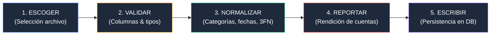
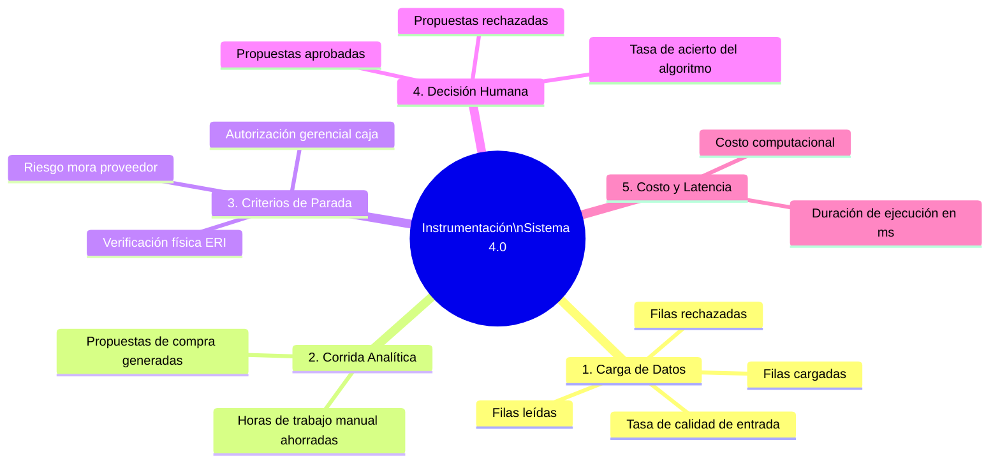

# 📊 Auditoría de Cambios Post-Limpieza, Ingesta en 5 Pasos e Instrumentación

Este skill es la **guía metodológica, algorítmica y de arquitectura de datos** para que cualquier LLM o agente de IA audite las transformaciones aplicadas sobre el catálogo de datos, valide el protocolo de ingesta de datos en cinco pasos y verifique la instrumentación autónoma del sistema de **Producción 4.0** de acuerdo con los principios de la cátedra **B4_02: "Del archivo al registro: La ingesta de datos y la instrumentación"**.

> [!IMPORTANT]
> **DIRECTIVA FUNDAMENTAL DE ARQUITECTURA B4_02:**
> 1. **El archivo no es el dato:** El archivo CSV o planilla de cálculo es la *remisión*; la base de datos relacional (Supabase) es el *Kardex* (el registro que manda).
> 2. **Erradicación de la Amnesia:** Operar sobre archivos volátiles genera pérdida de historia, ausencia de medición y ruptura de trazabilidad.
> 3. **Consumo Centralizado:** Una vez saneados e ingresados los datos, **ningún módulo analítico vuelve a tocar el archivo: todos leen directamente de la base de datos**.
> 4. **Rendición de Cuentas Obligatoria:** Toda carga de datos debe reportar con transparencia qué aceptó, qué rechazó y por qué (cero cargas silenciosas).

---

## 🏛️ 1. Matriz de Cambios Pre vs Post Limpieza (Auditoría Integral de Datos)

El pipeline de saneamiento determinístico y normalización relacional a Tercera Forma Normal (3FN) ejecutado en el proyecto ha corregido **763 inconsistencias críticas** distribuidas en las siguientes entidades maestras y transaccionales:

| Entidad | Registros (Raw ➔ Clean) | Inconsistencia Detectada en Archivo Fuente | Causa Raíz / Criterio de Falla | Transformación Aplicada en Limpieza | Impacto Operacional en la Cadena |
|---|:---:|---|---|---|---|
| **`movimientos_inventarios`** | 16.195 ➔ 16.195 | 15 movimientos fechados en `2026-13-05` | Error tipográfico en mes 13 por mes 03 (digitación operario OP-99) | Normalizado a `2026-03-05` (dentro de horizonte de evaluación de 21 meses) | Evita desplazar 467 unidades fuera del cierre contable de Marzo 2026. |
| **`movimientos_inventarios`** | 16.195 ➔ 16.195 | 466 transacciones con cantidades negativas | Confusión entre el valor numérico y el sentido contable | Conversión a valor absoluto $\|cantidad\|$; sentido gobernado por `tipo_movimiento = 'salida'` | Elimina distorsiones de signos en la reconstrucción del Kardex teórico. |
| **`ordenes_compra`** | 2.500 ➔ 2.500 | 22 órdenes con `fecha_recepcion` en año futuro 2035 | Error de captura de año futuro en el ERP | Imputación del año real a partir de `fecha_pedido` | Restablece el cálculo veraz de SLA y lead times reales de proveedores (sin moras de 10 años). |
| **`ordenes_compra`** | 2.500 ➔ 2.500 | Órdenes abiertas sin `fecha_recepcion` | Órdenes en tránsito pendientes de llegada | Preservadas con `fecha_recepcion = NULL` | Esencial para computar inventario en tránsito dentro de la posición neta de reorden. |
| **`maestro_materiales`** | 75 ➔ 75 | 54 SKUs con `lead_time_declarado_dias = NULL` | Omisión sistemática en configuración de compras del ERP | Triangulación empírica: 52 por compras históricas del SKU + 2 por mediana del proveedor | Permite calcular Stock de Seguridad ($SS$) y Punto de Reorden ($ROP$) sin puntos ciegos. |
| **`maestro_materiales`** | 75 ➔ 75 | 24 variantes tipográficas en categorías de insumos | Ausencia de listas desplegables estandarizadas en ERP | Mapeo léxico a 8 familias canónicas: *Lámina, Tornillería, Tubería, Pintura, Correderas, Adhesivos, Empaque, Vidrio* | Permite segmentación Pareto ABC y políticas de compras por familia consistentes. |
| **`maestro_materiales`** | 75 ➔ 75 | Variantes de mayúsculas/minúsculas y tildes en unidades | Dispersión de digitación (`KG`, `kg`, `M2`, `lmina`) | Normalización canónica a minúsculas: `kg`, `unidad`, `m`, `par`, `m2`, `lámina` | Cuadre exacto en la explosión de materiales del BOM. |
| **`bom` y `plan_produccion`** | 131 / 378 | Redundancia masiva de la columna descriptiva `nombre_producto` | Violación directa de la Tercera Forma Normal (3FN) | Creación de entidad maestra `maestro_productos` (18 productos) y clave atómica compuesta `id_bom = producto + '_' + sku_material` | Erradica anomalías de actualización y optimiza almacenamiento en Supabase. |
| **`conteo_fisico`** | 75 ➔ 75 | Cantidades negativas y registros duplicados | Error de digitación en planillas de conteo de piso | Saneamiento vía $\|valor\ absoluto\|$ y deduplicación | Base limpia para auditoría de veracidad de saldos (ERI). |
| **`inventario_bodega_JEFE`** | 75 ➔ 75 | Cantidades negativas y 51 observaciones nulas | Registros informales en el cuaderno auxiliar de patio | $\|valor\ absoluto\|$ e imputación con `'Sin observación'` | Reconciliación tridimensional integral (Kardex vs Conteo vs Jefe). |

---

## 🪜 2. El Protocolo Canónico de Ingesta en 5 Pasos (B4_02 Slide 5)

Toda incorporación o actualización de datos en el sistema debe ejecutar obligatoriamente las cinco etapas sin omitir ninguna:

### Reglas de Ejecución por Etapa:
1. **PASO 1 (ESCOGER):** El usuario o agente selecciona el archivo CSV/fuente. Se computa el hash SHA-256 para trazabilidad e idempotencia.
2. **PASO 2 (VALIDAR):** Se audita la presencia de columnas obligatorias y tipos de datos (numéricos, fechas ISO, llaves primarias no nulas).
3. **PASO 3 (NORMALIZAR - Dónde vive la IA y las reglas):**
   - Estandarización de familias léxicas mediante diccionarios y heurísticas.
   - Corrección de fechas inválidas (ej. mes 13).
   - Conversión de cantidades negativas a valor absoluto contable.
   - Normalización relacional a 3FN.
4. **PASO 4 (REPORTAR - La carga tiene que rendir cuentas):**
   - Generación de informe cuantitativo:
     $$\text{Filas Leídas} = \text{Filas Aceptadas (Cargadas)} + \text{Filas Rechazadas}$$
   - Todo registro rechazado debe detallar su causa raíz (ej. fecha ilegible, SKU vacío, clave huérfana).
   - Prohibidas las cargas silenciosas.
5. **PASO 5 (ESCRIBIR):** Inserción transaccional directa a las tablas de Supabase + Asiento en `public.bitacora_cargas`.

---

## 🔒 3. Los Dos Requisitos Duros de la Carga (B4_02 Slide 7 & 8)

Toda ingesta debe satisfacer dos propiedades formales que se verifican mediante la prueba de 10 minutos:

### 3.1 Carga Acumulativa
* **Definición:** Los datos nuevos se **SUMAN** a los registros existentes; no los borran, truncan ni sobreescriben la historia.
* **Justificación:** Una operación real recibe datos transaccionales de forma periódica (semanal o mensual). Si cada carga borrara la anterior, el sistema padecería de amnesia crónica.
* **Comprobación:** $\text{Filas Finales} = \text{Filas Iniciales} + \text{Filas Nuevas}$.

### 3.2 Carga Idempotente
* **Definición:** Cargar el **MISMO archivo dos veces consecutivas no duplica ningún registro**.
* **Justificación:** Los operadores humanos cargan archivos por duplicado frecuentemente. Si el sistema duplica, el inventario y las compras se inflan artificialmente, haciendo que las fórmulas (EOQ, ROP, ERI) arrojen decisiones equivocadas con cálculos matemáticamente exactos sobre datos corrompidos.
* **Comprobación:** Tras la segunda carga del mismo archivo, el conteo total en la base permanece estrictamente invariante ($\Delta \text{filas} = 0$).

---

## 📡 4. Instrumentación del Sistema: El Sistema se Mide Solo (Slide 9-11)

El sistema está instrumentado para monitorear su propio desempeño de forma autónoma a través de 5 dimensiones clave:

### 4.1 Tablas de Bitácora e Instrumentación en Supabase

#### `public.bitacora_cargas`
Registra la rendición de cuentas de cada ingesta de datos:
* `id` (PK), `fecha_carga`, `archivo_origen`, `tabla_destino`, `filas_leidas`, `filas_cargadas`, `filas_rechazadas`, `detalle_rechazos` (JSONB), `es_idempotente`, `duracion_ms`, `usuario_carga`.

#### `public.bitacora_corridas`
Registra la telemetría de cada corrida del orquestador:
* `corrida_id` (PK, ej. `RUN-20261019-183000`), `fecha_corrida`, `total_propuestas`, `inversion_total_cop`, `conteo_paradas` (JSONB), `propuestas_aprobadas`, `propuestas_rechazadas`, `duracion_ms`, `usuario`.

---

## 🛠️ 5. Herramientas y Módulos de Soporte en el Repositorio

1. **Módulo Central de Auditoría e Ingesta:**
   - [`nucleo/analisis_cambios.py`](file:///c:/Users/Julian/Documents/NOVENO%20SEMESTRE/ÉNFASIS-2/PA-E2/nucleo/analisis_cambios.py): Implementa las funciones `auditar_cambios_detallados()`, `ejecutar_ingesta_5_pasos()`, `simular_prueba_idempotencia_acumulativa()` y `obtener_telemetria_instrumentacion()`.
2. **Tablero Interactivo de Control:**
   - [`app.py`](file:///c:/Users/Julian/Documents/NOVENO%20SEMESTRE/ÉNFASIS-2/PA-E2/app.py): Pestaña dedicada *"📥 Ingesta 5 Pasos & Auditoría (B4.02)"* con simulador de los 5 pasos, matriz de cambios, taller de idempotencia y telemetría de corridas.
3. **DDL de Tablas de Instrumentación:**
   - [`sql/05_instrumentacion_y_bitacoras.sql`](file:///c:/Users/Julian/Documents/NOVENO%20SEMESTRE/ÉNFASIS-2/PA-E2/sql/05_instrumentacion_y_bitacoras.sql): Definición DDL de `bitacora_cargas` y `bitacora_corridas`.
4. **Documentación de Causa Raíz de Cambios:**
   - [`informes/DOCUMENTACION_IMPLICACIONES_CAMBIOS.md`](file:///c:/Users/Julian/Documents/NOVENO%20SEMESTRE/ÉNFASIS-2/PA-E2/informes/DOCUMENTACION_IMPLICACIONES_CAMBIOS.md): Bitácora técnica y sustentación de decisiones de saneamiento.

---

## ✅ 6. Checklist de Validación B4.02 ("Cómo saben que van bien")

Un LLM o auditor debe responder positivamente a estas seis preguntas de control (Slide 12):
* [x] **1. Rendición de Cuentas:** ¿La carga reporta cuántas filas aceptó, cuántas rechazó y el motivo de cada rechazo?
* [x] **2. Idempotencia:** ¿Cargar dos veces el mismo archivo no cambia nada ni duplica inventario?
* [x] **3. Acumulación:** ¿Los datos nuevos se suman a los viejos sin borrarlos?
* [x] **4. Consumo de Base:** ¿Ningún módulo lee de archivos CSV/Excel; todos consumen Supabase?
* [x] **5. Registro de Corridas:** ¿Cada corrida queda registrada en `bitacora_corridas` con fecha, propuestas y duración?
* [x] **6. Calibración de Paradas:** ¿Se puede auditar exactamente cuántas veces el sistema se detuvo y por qué motivo específico?
