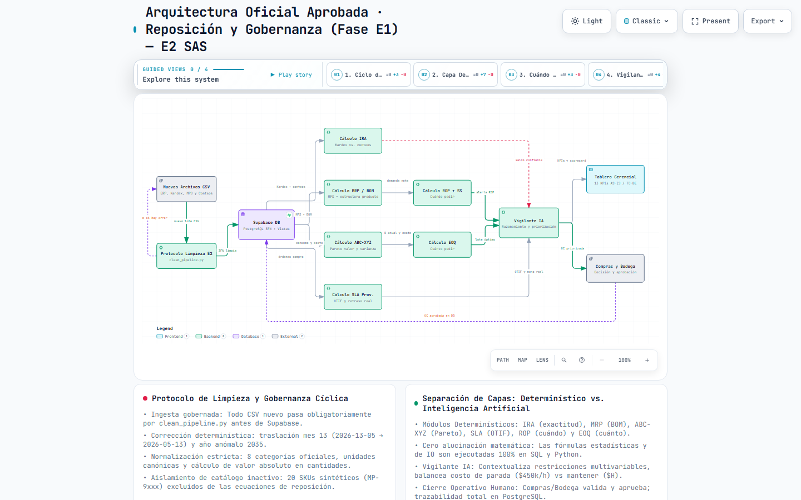
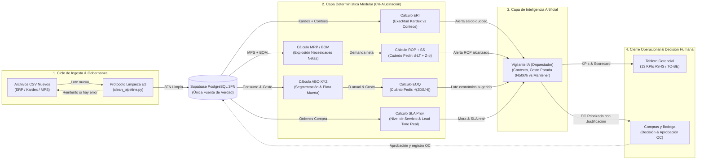
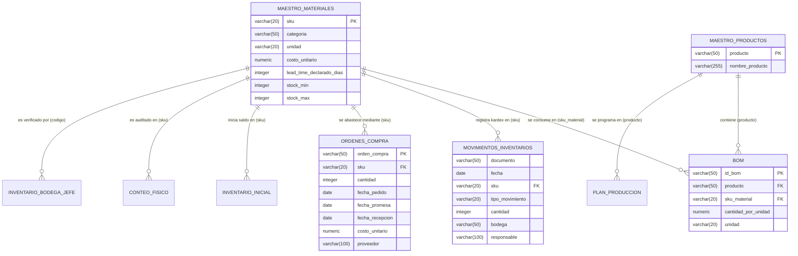

# 🏢 Sistema de Optimización y Reposición Inteligente de Inventarios — E2 SAS
> **Proyecto de Consultoría Analítica, Ingeniería de Datos e Investigación de Operaciones (Producción 4.0 / Énfasis 2)**  
> **Universidad de Medellín — Facultad de Ingeniería — Programa de Ingeniería Industrial**  
> **Fase:** E1 — Diagnóstico Operacional, Auditoría de Calidad, Línea Base y Arquitectura del Sistema  
> **Empresa:** E2 SAS (Manufactura de Mobiliario Metálico de Oficina)  
> **Repositorio Oficial:** [`https://github.com/juliancarmotrice-star/E2.git`](https://github.com/juliancarmotrice-star/E2.git)

---

## 📌 1. Resumen Ejecutivo del Proyecto

**E2 SAS** es una empresa colombiana con más de una década de experiencia en el diseño y manufactura de mobiliario metálico para oficina (archivadores, estanterías, escritorios, sillas y módulos operativos). Su operación productiva combina programación mensual contra pedidos y pronóstico de ventas, dependiendo de 420 referencias de materias primas (láminas de acero, tuberías, pintura electrostática, correderas, adhesivos, vidrio, tornillería y empaques).

Al iniciar la consultoría, la Gerencia de Operaciones reportaba una paradoja logística crítica: **quiebres de stock sistemáticos en insumos estratégicos que paralizaban la planta, en coexistencia con bodegas saturadas de inventario inmovilizado ("plata muerta") y desconfianza absoluta en el sistema ERP**.

```
                           SITUACIÓN DIAGNOSTICADA (AS-IS)
  ┌─────────────────────────────────────────────────────────────────────────────────┐
  │  • 301 de 420 SKUs (71.7%) sin ningún movimiento en 21 meses: $3.550 M COP      │
  │  • Costo anual de mantener inventario inútil (H=25%): $887.505.577 COP / año     │
  │  • SLA de proveedores en lámina de acero: apenas 2.80% (mora promedio 10.99 d)  │
  │  • Exactitud de Registro (ERI) en SKUs activos: 0.00% (100% de registros en rojo)│
  │  • Desalineación contable bruta Kardex vs. Conteo Físico: $48.760 M COP         │
  │  • Días de Suministro de Inventario (DSI): 736.5 días (24.5 meses de stock)      │
  └─────────────────────────────────────────────────────────────────────────────────┘
```

### 🎯 Principio Rector de la Solución
Para resolver la causa raíz del desabastecimiento sin incurrir en alucinaciones o sobrecostos tecnológicos, la solución se basa en una estricta separación de responsabilidades:

> **"El cálculo del reorden es una FÓRMULA MATEMÁTICA DETERMINÍSTICA ($ROP, SS, EOQ, ABC$), no Inteligencia Artificial. La Inteligencia Artificial se utiliza para LEER, VIGILAR, CONTEXTUALIZAR y ORQUESTAR la toma de decisiones humanas."**

---

## 🏛️ 2. Arquitectura Integral del Sistema (Fase E1 Aprobada)



El sistema opera mediante un circuito cerrado de 4 capas desacopladas que garantiza confiabilidad matemática, gobernanza de datos y trazabilidad operacional:



### 🗺️ Mapas de Arquitectura Interactivos
* 🏆 **Diagrama Oficial Final Aprobado (Fase E1):** [`diagrams/arquitectura-sistema-completo.html`](diagrams/arquitectura-sistema-completo.html) *(Abrir en navegador para explorador interactivo con temas claro/oscuro, 4 capítulos guiados y exportación en alta resolución SVG/PNG)*.
* 📂 **Diagrama Base Inicial (Histórico):** [`diagrams/arquitectura-reposicion.html`](diagrams/arquitectura-reposicion.html).
* 📄 **Especificación Técnica Completa:** [`informes/ARQUITECTURA_DEL_SISTEMA_REPOSICION.md`](informes/ARQUITECTURA_DEL_SISTEMA_REPOSICION.md).

---

## 🔍 3. Peritaje de Quejas Gerenciales (Diagnóstico AS-IS con Datos)

Durante la auditoría de 21 meses de transacciones (Julio 2024 a Marzo 2026), se contrastaron las percepciones de la gerencia contra la evidencia estadística:

| # | Queja de la Gerencia | Dictamen Pericial con Evidencia de Datos | Informe Técnico |
|---|---|---|:---:|
| **1** | *"Se agota la lámina cuando más pedidos hay y llega tarde."* | **Confirmado:** Lead Time real de lámina de **20.78 días vs. 12.11 días** declarados (+71.5% desfase). Cumplimiento de **SLA de entrega de apenas 2.80%**, acumulando **1.056 días de retraso** que expusieron a la planta a **8.448 horas de riesgo de parada** ($3.801.6M COP). | [`Ver Informe`](informes/INFORME_INVESTIGACION_QUEJA_GERENCIA_LAMINA.md) |
| **2** | *"La bodega está llena de plata muerta que no rota."* | **Confirmado:** **301 de 420 SKUs (71.67%)** no registraron ninguna salida en 21 meses. Representan **$3.550.022.309 COP inmovilizados**, costándole a la empresa **$887.505.577 COP anuales** en costo de posesión ($H=25\%$). | [`Ver Informe`](informes/INFORME_INVESTIGACION_QUEJA_GERENCIA_PLATA_MUERTA.md) |
| **3** | *"El sistema dice que hay stock, pero en bodega no está."* | **Confirmado:** **ERI (Exactitud en el Registro de Inventario) del 0.00% en los 119 SKUs activos**. El 100% de los insumos en movimiento presentan saldos desalineados por consumos asentados sin recepción previa, generando una brecha contable de **$48.760.853.889 COP** y el uso del *"cuaderno paralelo"*. | [`Ver Informe`](informes/INFORME_INVESTIGACION_QUEJA_GERENCIA_INEXACTITUD_INVENTARIO.md) |
| **4** | *"La demanda de archivadores y estanterías nos coge por sorpresa."* | **Confirmado:** Coeficiente de variación de demanda ($CV = 48.7\%$) en archivadores operando sin **Stock de Seguridad dinámico ($SS$)** ni explosión automatizada de BOM, amplificando el efecto látigo hacia láminas y correderas. | [`Ver Informe`](informes/INFORME_INVESTIGACION_QUEJA_GERENCIA_VARIABILIDAD_DEMANDA_BOM.md) |

---

## 📊 4. Scorecard Maestro de Línea Base (AS-IS vs. Metas TO-BE)

Cuantificación monetaria de las ineficiencias según los parámetros oficiales del encargo ($S = \$80.000\text{ COP/OC}$, $H = 25\%\text{ anual}$, $C_{\text{parada}} = \$450.000\text{ COP/h}$):

| Dimensión | Indicador Clave (KPI) | Valor Medido Actual (Línea Base AS-IS) | Meta Esperada (Fase TO-BE) | Brecha Operativa | Impacto Financiero en Riesgo ($ COP) |
|---|---|:---:|:---:|:---:|:---:|
| **Suministro** | **SLA Global de Proveedores (A Tiempo)** | **`6.08%`** | $\ge 95.00\%$ | -88.92% | Desabastecimiento crónico de insumos |
| **Suministro** | **SLA en Láminas de Acero** | **`2.80%`** | $\ge 95.00\%$ | -92.20% | Principal cuello de botella de corte |
| **Suministro** | **Lead Time Real Lámina vs. ERP** | **`20.78d` vs `12.11d`** | $LT_{\text{real}} = LT_{\text{ERP}}$ | +8.67 días (+71.5%) | Compras emitidas a destiempo |
| **Suministro** | **Mora Promedio en OC Atrasadas** | **`10.99 días`** | $0\text{ días}$ | +10.99 días | 14.417 días de mora acumulada |
| **Inventario** | **Exactitud de Registro (ERI Activos)** | **`0.00%`** | $\ge 98.00\%$ | -98.00% | 119 de 119 SKUs activos desalineados |
| **Inventario** | **Desalineación Contable Bruta** | **`$48.760 M COP`** | $< \$500\text{ M COP}$ | Descuadre Kardex vs Piso | Incongruencia en estados financieros |
| **Inventario** | **Días de Suministro (DSI Global)** | **`736.5 días` (24.5 m)** | $\le 60\text{ días}$ (2 m) | +676.5 días de exceso | Exceso masivo de capital de trabajo |
| **Inventario** | **Rotación Anual de Inventario (ITR)** | **`0.495 veces/año`** | $\ge 6.00\text{ veces/año}$ | -91.74% de lentitud | Inmovilidad severa del inventario |
| **Inventario** | **Capital en Plata Muerta** | **`$3.550 M COP` (53.99%)** | $< 5.00\%$ | +48.99% inútil | **`$887.505.577 COP / año`** ($H=25\%$) |
| **Manufactura** | **Cumplimiento Plan Producción (MPS)** | **`97.29%`** | $\ge 99.50\%$ | -753 unidades PT | 19 de 21 meses con caídas de ensamble |
| **Manufactura** | **Riesgo Paradas de Planta (Lámina)** | **`8.448 horas`** | $0\text{ horas}$ | Mora en compras | **`$3.801.600.000 COP`** ($450k/h) |
| **Compras** | **Emisión Reactiva de OC** | **`1.471 OC emitidas`** | Reducir en 35% | Pedidos pulverizados | **`$117.680.000 COP`** ($80k/OC) |

📄 *Detalle metodológico:* [`informes/LINEA_BASE_Y_CUANTIFICACION_DE_COSTOS.md`](informes/LINEA_BASE_Y_CUANTIFICACION_DE_COSTOS.md) y [`informes/INFORME_FINAL_DIAGNOSTICO_Y_LINEA_BASE_E1.md`](informes/INFORME_FINAL_DIAGNOSTICO_Y_LINEA_BASE_E1.md).

---

## 💾 5. Modelo de Datos Relacional en Supabase (PostgreSQL 3FN)

El modelo de datos se normalizó en **Tercera Forma Normal (3FN)** con claves foráneas, restricciones de no nulidad e integridad referencial estricta:



### 📐 Vistas Analíticas Implementadas en Base de Datos:
1. **`public.vista_clasificacion_abc`:** Clasificación dinámica de Pareto (80-15-5) con participación individual y acumulada formateada ([`sql/03_vistas_analiticas_abc.sql`](sql/03_vistas_analiticas_abc.sql)).
2. **`public.vista_calculo_eoq_rop`:** Cálculo determinístico de **Lote Económico ($EOQ$)**, **Stock de Seguridad ($SS$)** y **Punto de Reorden ($ROP$)** al **95% de nivel de servicio ($Z=1.64485$)**, integrando la variabilidad de la demanda diaria ($\sigma_d$) y del lead time real de los proveedores ($\sigma_L$) con semáforo dinámico de inventario ([`sql/04_vistas_calculo_eoq_rop.sql`](sql/04_vistas_calculo_eoq_rop.sql)).

---

## 🗂️ 6. Estructura del Repositorio

```
PA-E2/
│
├── 📁 datos_iniciales/          # Datos crudos y documentación base del encargo
│   ├── bom.csv                  # Lista de materiales (BOM) sin procesar
│   ├── conteo_fisico.csv        # Conteo físico de auditoría
│   ├── Inventario_bodega_JEFE.csv # Cuaderno paralelo del jefe de bodega
│   ├── inventario_inicial.csv   # Saldo inicial a 2024-07-01
│   ├── maestro_materiales.csv   # Catálogo con 24 variantes léxicas y 54 lead times nulos
│   ├── movimientos_inventario.csv # Kardex con 16.195 registros y fechas atípicas
│   ├── ordenes_compra.csv       # Historial de compras con años 2035 y órdenes abiertas
│   ├── plan_produccion.csv      # Plan mensual vs ejecución real
│   └── 01_Encargo_de_consultoria.pdf # Documento oficial del encargo
│
├── 📁 datos_limpios/            # Datasets depurados, normalizados (3FN) y validados
│   ├── bom_clean.csv            # BOM normalizado con ID compuesto único (131 filas)
│   ├── conteo_fisico_clean.csv  # Conteo físico saneado (|Q| >= 0)
│   ├── inventario_bodega_JEFE_clean.csv # Conteo jefe sin negativos y notas imputadas
│   ├── inventario_inicial_clean.csv     # Inventario inicial verificado
│   ├── maestro_materiales_clean.csv     # 8 categorías canónicas y 54 LT imputados
│   ├── maestro_productos_clean.csv      # Catálogo maestro de 18 productos terminados
│   ├── movimientos_inventario_clean.csv # Kardex saneado (fechas y cantidades positivas)
│   ├── ordenes_compra_clean.csv         # Años 2035 corregidos a fechas reales
│   └── plan_produccion_clean.csv        # Plan normalizado sin redundancia
│
├── 📁 python/                   # Scripts y pipelines de ingeniería de datos y analítica
│   ├── clean_pipeline.py        # Pipeline ETL canónico de limpieza y normalización
│   ├── upload_to_supabase.py    # Inserción automatizada por lotes a Supabase
│   └── 📁 analisis/             # Scripts periciales y cálculos de auditoría
│       ├── audit_dataset.py     # Auditoría estadística de calidad por tabla
│       ├── audit_findings.py    # Auditoría transversal y reconciliación tridimensional
│       └── deep_analysis.py     # Análisis de hipótesis gerenciales, ABC y variación
│
├── 📁 sql/                      # Scripts y esquemas DDL / DML para PostgreSQL / Supabase
│   ├── 01_auditoria_duplicados_e_integridad.sql # Verificación de integridad referencial
│   ├── 02_diagnostico_sla_proveedores_y_produccion.sql # Diagnóstico de tiempos y entregas
│   ├── 03_vistas_analiticas_abc.sql # Vista dinámica de clasificación ABC (Pareto)
│   ├── 04_vistas_calculo_eoq_rop.sql # Vista determinística de Lote Económico y ROP (95% SL)
│   ├── consultas_analiticas_kpis.sql # Consultas analíticas y KPIs de línea base
│   ├── limpieza_datos.sql       # Procedimientos de limpieza SQL nativos
│   ├── supabase_schema_foreign_keys.sql # DDL de llaves foráneas e integridad referencial
│   ├── supabase_crear_maestro_productos.sql # Creación de tabla maestra de productos
│   └── supabase_bom_pk.sql      # Llave primaria compuesta para BOM
│
├── 📁 informes/                 # Documentación técnica e informes de consultoría
│   ├── ARQUITECTURA_DEL_SISTEMA_REPOSICION.md # Arquitectura conceptual y técnica del sistema
│   ├── INFORME_FINAL_DIAGNOSTICO_Y_LINEA_BASE_E1.md # Documento técnico maestro E1
│   ├── INFORME_SUSTENTACION_JUNTA_DIRECTIVA_E1.md   # Informe ejecutivo para Junta Directiva
│   ├── BITACORA_DE_LIMPIEZA.md                      # Bitácora metodológica de saneamiento
│   ├── LINEA_BASE_Y_CUANTIFICACION_DE_COSTOS.md     # Cuantificación financiera de ineficiencia
│   ├── DIAGNOSTICO_BASE_DE_DATOS_SUPABASE.md        # Arquitectura del modelo relacional
│   ├── INFORME_CRUCE_VALORES_NULOS_E_IMPLICACIONES.md # Análisis de nulos y órdenes abiertas
│   ├── DOCUMENTACION_IMPLICACIONES_CAMBIOS.md       # Justificación de ajustes en BD
│   ├── INFORME_INVESTIGACION_QUEJA_GERENCIA_LAMINA.md # Peritaje Queja 1 (Lead Times)
│   ├── INFORME_INVESTIGACION_QUEJA_GERENCIA_PLATA_MUERTA.md # Peritaje Queja 2 (Plata Muerta)
│   ├── INFORME_INVESTIGACION_QUEJA_GERENCIA_INEXACTITUD_INVENTARIO.md # Peritaje Queja 3 (IRA)
│   └── INFORME_INVESTIGACION_QUEJA_GERENCIA_VARIABILIDAD_DEMANDA_BOM.md # Peritaje Queja 4 (BOM)
│
├── 📁 presentaciones/           # Diapositivas y material de preparación para sustentación oral
│   ├── Sustentacion_Junta_Directiva_E2SAS_E1.pptx # Presentación con notas de orador
│   ├── Sustentacion_Junta_Directiva_E2SAS_E1_Limpia.pptx # Presentación limpia
│   ├── GUIA_PREPARACION_SUSTENTACION_DIAPOSITIVAS_E1.pdf # Guía en PDF para exposición
│   ├── GUIA_PREPARACION_SUSTENTACION_DIAPOSITIVAS_E1.md  # Libreto diapositiva por diapositiva
│   └── GUIA_PREPARACION_EXPOSICION_E1.md                # Estrategia de defensa oral
│
├── 📁 diagrams/                 # Mapas interactivos de arquitectura (Archify)
│   ├── arquitectura-sistema-completo.html # 🏆 DIAGRAMA OFICIAL FINAL APROBADO (Fase E1)
│   ├── arquitectura-sistema-completo.architecture.json
│   ├── arquitectura-reposicion.html       # Diagrama base inicial (histórico)
│   └── arquitectura-reposicion.architecture.json
│
├── 📁 .agents/skills/limpieza-datos-e2/  # Protocolo fijo de limpieza para cada nueva carga CSV
│
├── 📁 resultados_auditoria/     # Salidas estructuradas en JSON de auditorías
│   ├── audit_findings.json      # Reporte detallado de hallazgos por tabla
│   ├── audit_summary.json       # Resumen ejecutivo de calidad de datos
│   └── deep_analysis_results.json # Resultados cuantitativos de hipótesis gerenciales
│
├── .env.example                 # Plantilla de variables de entorno para Supabase
├── .gitignore                   # Exclusiones de control de versiones
└── README.md                    # Índice maestro del proyecto
```

---

## 🚀 7. Instrucciones de Reproducción y Ejecución

### 7.1 Clonar el Repositorio
```bash
git clone https://github.com/juliancarmotrice-star/E2.git
cd E2
```

### 7.2 Configuración del Entorno Virtual (Python)
```bash
# Crear entorno virtual
python -m venv venv

# Activar entorno (PowerShell en Windows)
.\venv\Scripts\Activate.ps1

# Instalar dependencias
pip install -r requirements.txt
```

### 7.3 Ejecutar el Pipeline ETL de Limpieza y Normalización
```bash
python python/clean_pipeline.py
```

### 7.4 Ejecutar las Auditorías Estadísticas y Periciales
```bash
python python/analisis/audit_dataset.py
python python/analisis/audit_findings.py
python python/analisis/deep_analysis.py
```

### 7.5 Carga Automatizada a Supabase
1. Configura tus credenciales en un archivo `.env` a partir de `.env.example`:
   ```env
   SUPABASE_URL=https://tu-proyecto.supabase.co
   SUPABASE_SERVICE_ROLE_KEY=tu_service_role_key
   ```
2. Ejecuta la inserción por lotes:
   ```bash
   python python/upload_to_supabase.py
   ```

---

## 👥 Equipo Consultor & Créditos Institucionales
* **Proyecto Académico-Empresarial:** Énfasis 2 / Producción 4.0
* **Institución:** Universidad de Medellín — Facultad de Ingeniería — Ingeniería Industrial
* **Empresa Cliente:** E2 SAS
* **Líder de Proyecto & Consultoría:** Julian Carmona Madrigal ([@juliancarmotrice-star](https://github.com/juliancarmotrice-star))
