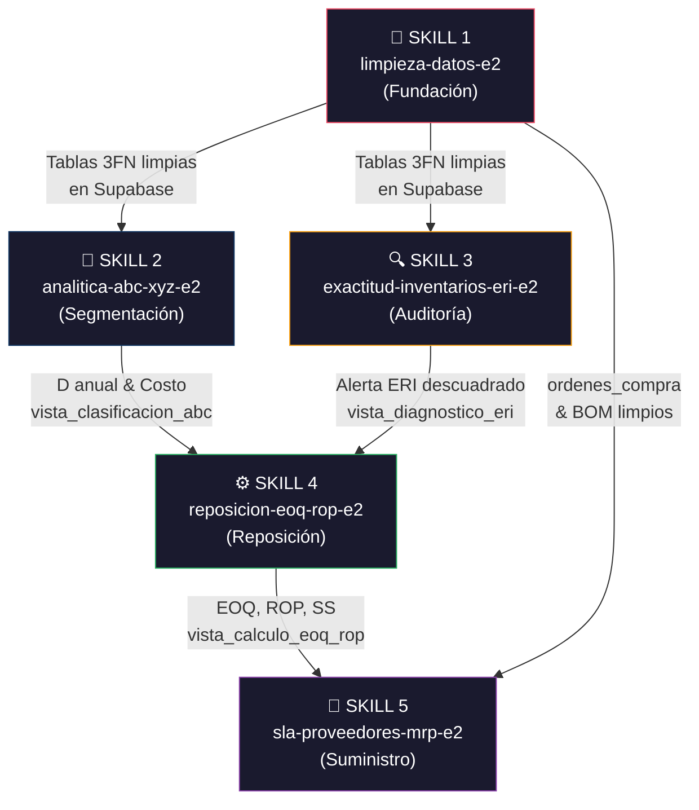

# 🏗️ Arquitectura de Skills del Proyecto E2 SAS
> **Sistema de Optimización y Reposición Inteligente de Inventarios**  
> Organización completa de las 5 skills operativas: cuándo se usa cada una, procedimiento, vistas SQL y verificación de calidad.

---

## 📐 Mapa General: Orden de Ejecución y Dependencias

Las skills siguen un **flujo secuencial obligatorio** donde la salida de una alimenta la entrada de la siguiente. No se puede saltar etapas.



---

## 🔑 Tabla Resumen Rápido

| # | Skill | Indicador de Uso (¿Cuándo?) | Vista SQL en Supabase | Verificación |
|:-:|-------|----------------------------|----------------------|-------------|
| 1 | [`limpieza-datos-e2`](file:///c:/Users/Julian/Documents/NOVENO%20SEMESTRE/ÉNFASIS-2/PA-E2/.agents/skills/limpieza-datos-e2/SKILL.md) | Llegan archivos CSV nuevos del ERP o se modifica el catálogo | *(No tiene vista propia — alimenta las 4 vistas restantes)* | Checklist de integridad referencial: 0 huérfanos, 0 nulos, 0 fechas inválidas |
| 2 | [`analitica-abc-xyz-e2`](file:///c:/Users/Julian/Documents/NOVENO%20SEMESTRE/ÉNFASIS-2/PA-E2/.agents/skills/analitica-abc-xyz-e2/SKILL.md) | Se necesita clasificar SKUs, detectar plata muerta o definir políticas de compra diferenciadas | `public.vista_clasificacion_abc` | Clase A ≤ 80% acumulado, A+B+C = 100%, Plata Muerta con D=0 bloqueada |
| 3 | [`exactitud-inventarios-eri-e2`](file:///c:/Users/Julian/Documents/NOVENO%20SEMESTRE/ÉNFASIS-2/PA-E2/.agents/skills/exactitud-inventarios-eri-e2/SKILL.md) | Se requiere auditar si el Kardex del ERP coincide con lo que hay físicamente en bodega | `public.vista_diagnostico_eri_inventarios` + `public.vista_resumen_eri_inventarios` | ERI% calculado correctamente, Δ=0 → Exacto, semáforo coherente con discrepancia |
| 4 | [`reposicion-eoq-rop-e2`](file:///c:/Users/Julian/Documents/NOVENO%20SEMESTRE/ÉNFASIS-2/PA-E2/.agents/skills/reposicion-eoq-rop-e2/SKILL.md) | Se necesita saber cuánto y cuándo pedir cada material (sugerencia de compra) | `public.vista_calculo_eoq_rop` | EOQ=0 para Plata Muerta, semáforo CRITICO si stock ≤ SS, inversión = EOQ × Costo |
| 5 | [`sla-proveedores-mrp-e2`](file:///c:/Users/Julian/Documents/NOVENO%20SEMESTRE/ÉNFASIS-2/PA-E2/.agents/skills/sla-proveedores-mrp-e2/SKILL.md) | Se evalúa desempeño de proveedores o se necesita explotar el BOM para planificar compras | *(Consultas SQL directas sobre tablas maestras)* | SLA% = OCs a tiempo / Total OCs, Lead Time real vs declarado coherente, MRP bruto = MPS × BOM |

---

## 🧹 SKILL 1: Limpieza de Datos (`limpieza-datos-e2`)

### 🚦 Indicador de Activación — ¿Cuándo se usa?

| Trigger | Ejemplo concreto |
|---------|------------------|
| Llegan **archivos CSV nuevos** del ERP | El área de compras exporta nuevas órdenes de compra del mes |
| Se **modifica o extiende** el catálogo de materiales | Se agregan 50 SKUs nuevos al maestro |
| Se **detectan inconsistencias** en Supabase | Un SKU aparece en `movimientos_inventarios` pero no en `maestro_materiales` |
| Se necesita **re-ejecutar** todo el pipeline desde cero | Cambio masivo en el dataset base |

### 📋 Procedimiento Paso a Paso

```
 PASO 1 → Colocar archivos crudos en datos_iniciales/*.csv (INMUTABLES, nunca editar)
    │
    ▼
 PASO 2 → Ejecutar: python python/clean_pipeline.py
           • Normaliza familias léxicas (24 variantes → 8 canónicas)
           • Imputa Lead Times nulos (3 reglas de triangulación)
           • Corrige fechas inválidas (mes 13, años 2035)
           • Aplica |valor absoluto| a cantidades negativas
           • Normaliza BOM a 3FN (id_bom compuesto)
    │
    ▼
 PASO 3 → Genera datos_limpios/*_clean.csv (9 archivos normalizados)
    │
    ▼
 PASO 4 → Cargar en Supabase: python python/upload_to_supabase.py
    │
    ▼
 PASO 5 → Ejecutar DDL de vistas: sql/03_vistas_analiticas_abc.sql
           y sql/04_vistas_calculo_eoq_rop.sql
```

### 🗄️ Vistas SQL que Habilita

Esta skill **no tiene vista propia**, pero es el **prerrequisito obligatorio** para que funcionen las 4 vistas:

| Vista Habilitada | Archivo DDL |
|-----------------|-------------|
| `public.vista_clasificacion_abc` | [`03_vistas_analiticas_abc.sql`](file:///c:/Users/Julian/Documents/NOVENO%20SEMESTRE/ÉNFASIS-2/PA-E2/sql/03_vistas_analiticas_abc.sql) |
| `public.vista_calculo_eoq_rop` | [`04_vistas_calculo_eoq_rop.sql`](file:///c:/Users/Julian/Documents/NOVENO%20SEMESTRE/ÉNFASIS-2/PA-E2/sql/04_vistas_calculo_eoq_rop.sql) |
| `public.vista_diagnostico_eri_inventarios` | Definida dentro de [`04_vistas_calculo_eoq_rop.sql`](file:///c:/Users/Julian/Documents/NOVENO%20SEMESTRE/ÉNFASIS-2/PA-E2/sql/04_vistas_calculo_eoq_rop.sql) |
| `public.vista_resumen_eri_inventarios` | Definida dentro de [`04_vistas_calculo_eoq_rop.sql`](file:///c:/Users/Julian/Documents/NOVENO%20SEMESTRE/ÉNFASIS-2/PA-E2/sql/04_vistas_calculo_eoq_rop.sql) |

### ✅ Verificación de Calidad

| # | Check | Query de Verificación | Resultado Esperado |
|:-:|-------|----------------------|-------------------|
| 1 | **Cero claves huérfanas** | `SELECT sku FROM movimientos_inventarios WHERE sku NOT IN (SELECT sku FROM maestro_materiales)` | **0 filas** |
| 2 | **Cero productos huérfanos** | `SELECT producto FROM bom WHERE producto NOT IN (SELECT producto FROM maestro_productos)` | **0 filas** |
| 3 | **Cero nulos en campos críticos** | `SELECT COUNT(*) FROM maestro_materiales WHERE costo_unitario IS NULL OR lead_time_declarado_dias IS NULL` | **0** |
| 4 | **Cero fechas inválidas** | `SELECT * FROM movimientos_inventarios WHERE EXTRACT(MONTH FROM fecha) > 12` | **0 filas** |
| 5 | **Conteo de tablas cargadas** | `SELECT COUNT(*) FROM maestro_materiales` | **≥ 420 registros** (o N según catálogo) |

---

## 🧠 SKILL 2: Analítica ABC-XYZ (`analitica-abc-xyz-e2`)

### 🚦 Indicador de Activación — ¿Cuándo se usa?

| Trigger | Ejemplo concreto |
|---------|------------------|
| Se necesita **clasificar los SKUs** por valor de consumo | Informe de categorización para Gerencia |
| Se quiere **detectar Plata Muerta** (capital inmovilizado) | Auditoría de bodega para liberar espacio |
| Se requiere **definir políticas diferenciadas** de compra | Decidir qué materiales comprar bajo pedido vs. stock |
| Se busca la **matriz cruzada ABC-XYZ** | Cruzar valor monetario con estabilidad de demanda |

### 📋 Procedimiento Paso a Paso

```
 PASO 1 → Consultar vista: SELECT * FROM public.vista_clasificacion_abc
           (Ya calcula automáticamente D_anual, V_anual, % acumulado y clase ABC)
    │
    ▼
 PASO 2 → Para XYZ: Calcular CV mensual por SKU
           • Construir serie d(i,m) con zero-padding obligatorio
           • CV = σ_d / d̄  →  X (≤0.50), Y (≤1.00), Z (>1.00)
    │
    ▼
 PASO 3 → Cruzar matriz 3×3 (AX, AY, AZ, BX, BY, BZ, CX, CY, CZ)
    │
    ▼
 PASO 4 → Aislar Plata Muerta: SKUs con D=0 y stock > 0
           • Cuantificar capital atrapado = Stock × Costo_Unitario
           • Costo posesión anual = Capital × 25%
    │
    ▼
 PASO 5 → Emitir políticas operativas diferenciadas por celda de la matriz
```

### 🗄️ Vista SQL en Supabase

**`public.vista_clasificacion_abc`** — Calcula dinámicamente:

```sql
-- Ranking completo ABC con Pareto dinámico
SELECT sku, descripcion, categoria, costo_unitario_formato,
       consumo_anual_formato, valor_consumo_anual_formato,
       pct_participacion_formato, pct_acumulado_formato,
       clasificacion_abc
FROM public.vista_clasificacion_abc
ORDER BY valor_consumo_anual_cop DESC;

-- Resumen por categoría ABC
SELECT clasificacion_abc, COUNT(*) AS total_skus,
       TO_CHAR(SUM(pct_participacion_individual), 'FM990.00') || ' %' AS pct_valor
FROM public.vista_clasificacion_abc
GROUP BY clasificacion_abc ORDER BY clasificacion_abc;
```

### ✅ Verificación de Calidad

| # | Check | Cómo Verificar | Resultado Esperado |
|:-:|-------|----------------|-------------------|
| 1 | **Suma de participación = 100%** | `SELECT SUM(pct_participacion_individual) FROM vista_clasificacion_abc` | **≈ 100.00%** |
| 2 | **Clase A ≤ 80% acumulado** | El último SKU de Clase A debe tener `pct_acumulado ≤ 80%` (borde inclusivo) | Corte en ≈80% |
| 3 | **Total SKUs = N** | `SELECT COUNT(*) FROM vista_clasificacion_abc` | **= N total del catálogo** |
| 4 | **Plata Muerta con D=0 bloqueada** | Todos los SKUs con `consumo_anual = 0` deben ser Clase C | EOQ=0, ROP=0 |
| 5 | **Pareto concentrado** | ~7% de SKUs (Clase A) concentran ~80% del valor | Ratio consistente |

---

## 🔍 SKILL 3: Exactitud de Inventarios ERI (`exactitud-inventarios-eri-e2`)

### 🚦 Indicador de Activación — ¿Cuándo se usa?

| Trigger | Ejemplo concreto |
|---------|------------------|
| Se necesita **validar si el Kardex es confiable** | Antes de emitir órdenes de compra |
| Se realizó un **conteo físico** nuevo en bodega | Auditoría de fin de mes o ciclo |
| Se quiere **cuantificar la desalineación contable** | Reporte de $COP descuadrados para Contabilidad |
| Se detecta una **queja de "stock fantasma"** | "El sistema dice 100 pero en bodega hay 20" |

### 📋 Procedimiento Paso a Paso

```
 PASO 1 → Consultar vista resumen: SELECT * FROM public.vista_resumen_eri_inventarios
           (Obtiene ERI% global, SKUs exactos vs descuadrados, desalineación total)
    │
    ▼
 PASO 2 → Consultar vista detalle: SELECT * FROM public.vista_diagnostico_eri_inventarios
           WHERE estado_eri LIKE 'Descuadrado%'
           ORDER BY desalineacion_dinero_cop DESC
           (Top SKUs con mayor error monetario)
    │
    ▼
 PASO 3 → Reconciliación tridimensional por SKU:
           • K_i = Stock Inicial + Entradas - Salidas + Ajustes (Kardex teórico)
           • F_i = Conteo Físico Oficial (auditoría piso)
           • J_i = Conteo Jefe de Bodega (cuaderno paralelo)
    │
    ▼
 PASO 4 → Calcular: Δ_i = F_i - K_i
           • Δ=0 → 🟢 Exacto
           • Δ<0 → 🔴 Faltante físico (merma)
           • Δ>0 → 🟡 Sobrante físico (no registrado)
    │
    ▼
 PASO 5 → Cuantificar desalineación: M_i = |Δ_i| × Costo_Unitario_i
```

### 🗄️ Vistas SQL en Supabase

**`public.vista_resumen_eri_inventarios`** — Métricas globales:

```sql
SELECT tipo_rotacion, total_skus, skus_exactos, skus_descuadrados,
       eri_porcentaje_exactitud, desalineacion_contable_bruta
FROM public.vista_resumen_eri_inventarios;
```

**`public.vista_diagnostico_eri_inventarios`** — Detalle fila por fila:

```sql
SELECT sku, descripcion, stock_kardex_formato, stock_fisico_formato,
       discrepancia_formato, desalineacion_dinero_formato, estado_eri
FROM public.vista_diagnostico_eri_inventarios
WHERE sku = 'MP-0001';  -- Cualquier SKU
```

### ✅ Verificación de Calidad

| # | Check | Cómo Verificar | Resultado Esperado |
|:-:|-------|----------------|-------------------|
| 1 | **ERI coherente con conteos** | `SKUs exactos + descuadrados = N total` | Suma = total catálogo |
| 2 | **Kardex reconstruido correctamente** | `Stock_Kardex = Inicial + Σ Entradas - Σ Salidas + Σ Ajustes` | Fórmula cuadra por SKU |
| 3 | **Desalineación = \|Δ\| × Costo** | Verificar 3-5 SKUs manualmente | Cifras coinciden |
| 4 | **Semáforo coherente** | Δ=0 → Exacto, Δ<0 → Faltante, Δ>0 → Sobrante | Sin contradicciones |
| 5 | **Total SKUs evaluados** | `SELECT COUNT(*) FROM vista_diagnostico_eri_inventarios` | **= N** |

---

## ⚙️ SKILL 4: Reposición EOQ / ROP / SS (`reposicion-eoq-rop-e2`)

### 🚦 Indicador de Activación — ¿Cuándo se usa?

| Trigger | Ejemplo concreto |
|---------|------------------|
| Se necesita saber **cuánto pedir** de un material | Sugerencia de lote económico (EOQ) |
| Se necesita saber **cuándo pedir** (punto de reorden) | Stock cayó por debajo del ROP |
| Se requiere un **semáforo de stock** actual | Dashboard de estado de inventario |
| Se busca **cuantificar la inversión** de un ciclo de compra | Presupuesto de compras del mes |

### 📋 Procedimiento Paso a Paso

```
 PASO 1 → Consultar vista: SELECT * FROM public.vista_calculo_eoq_rop
           WHERE semaforo_inventario IN ('1_CRITICO_QUIEBRE', '2_ALERTA_REORDEN')
    │
    ▼
 PASO 2 → La vista ya calcula dinámicamente los 8 pasos:
           • D_i = Demanda anualizada (Q_consumo × 365/T_días)
           • d̄_i = D_i / 300 (demanda diaria laboral)
           • EOQ_i = ⌈√(2·D·S / H·Cu)⌉  (S=$80k, H=25%)
           • L̄_i, σ_L = Lead Time real promedio y desviación
           • SS_i = ⌈Z · σ_L · d̄⌉  (Z=1.64485 al 95%)
           • ROP_i = ⌈d̄ · L̄ + SS⌉
           • Stock disponible = Físico + OCs en tránsito
           • Semáforo = CRITICO / ALERTA / NORMAL / PLATA_MUERTA
    │
    ▼
 PASO 3 → Verificar advertencia ERI antes de aprobar compra:
           SELECT estado_eri FROM vista_diagnostico_eri_inventarios
           WHERE sku = 'MP-XXXX'
           (Si está descuadrado → validar físicamente primero)
    │
    ▼
 PASO 4 → Cuantificar inversión: Inversión = EOQ_i × Cu_i
```

**Parámetros económicos fijos del modelo:**

| Parámetro | Símbolo | Valor | Unidad |
|-----------|:-------:|:-----:|:------:|
| Costo de emisión por OC | $S$ | $80.000 | COP/orden |
| Tasa anual de posesión | $H$ | 25% | Anual |
| Nivel de servicio | $SL$ | 95% | Probabilidad |
| Factor Z normal | $Z$ | 1.64485 | Adimensional |
| Costo parada de línea | $C_{parada}$ | $450.000 | COP/hora |
| Días laborales/año | $T_{lab}$ | 300 | Días |

### 🗄️ Vista SQL en Supabase

**`public.vista_calculo_eoq_rop`** — Motor determinístico completo:

```sql
-- Materiales que requieren compra inmediata
SELECT sku, descripcion, stock_actual_disponible_und,
       eoq_lote_economico_und, stock_seguridad_und,
       rop_punto_reorden_und, semaforo_inventario,
       inversion_eoq_formato, accion_sugerida
FROM public.vista_calculo_eoq_rop
WHERE semaforo_inventario IN ('1_CRITICO_QUIEBRE', '2_ALERTA_REORDEN')
ORDER BY semaforo_inventario ASC, inversion_eoq_cop DESC;

-- Resumen por semáforo
SELECT semaforo_inventario, COUNT(*) AS total_skus,
       '$ ' || TO_CHAR(SUM(inversion_eoq_cop), 'FM999,999,999,990') || ' COP' AS inversion_total
FROM public.vista_calculo_eoq_rop
GROUP BY semaforo_inventario ORDER BY semaforo_inventario;
```

### ✅ Verificación de Calidad

| # | Check | Cómo Verificar | Resultado Esperado |
|:-:|-------|----------------|-------------------|
| 1 | **Plata Muerta bloqueada** | `SELECT * FROM vista_calculo_eoq_rop WHERE semaforo='4_PLATA_MUERTA' AND eoq_lote_economico_und > 0` | **0 filas** (EOQ=0 siempre para D=0) |
| 2 | **Semáforo coherente** | Stock ≤ SS → CRITICO, SS < Stock ≤ ROP → ALERTA, Stock > ROP → NORMAL | Sin contradicciones |
| 3 | **EOQ positivo para activos** | `SELECT * FROM vista_calculo_eoq_rop WHERE demanda_anual_und > 0 AND eoq_lote_economico_und = 0` | **0 filas** |
| 4 | **Inversión = EOQ × Costo** | Verificar 3-5 SKUs manualmente | Cifras cuadran |
| 5 | **Lead Time real ≠ teórico** | Comparar `lead_time_real_dias` vs `lead_time_declarado_dias` en maestro | Usa el real, no el teórico |

---

## 🚢 SKILL 5: SLA Proveedores y MRP (`sla-proveedores-mrp-e2`)

### 🚦 Indicador de Activación — ¿Cuándo se usa?

| Trigger | Ejemplo concreto |
|---------|------------------|
| Se necesita **evaluar a los proveedores** | ¿Qué tan puntuales son? ¿Cuánta mora acumulan? |
| Se quiere **comparar Lead Time real vs. declarado** | Negociación con proveedores de lámina |
| Se requiere **explotar el BOM** para un plan de producción | MRP: ¿cuánto material necesito para producir 500 archivadores? |
| Se busca **calcular necesidades netas** de compra | Requerimiento bruto - stock disponible - OCs en tránsito |

### 📋 Procedimiento Paso a Paso

#### Componente A: Auditoría SLA de Proveedores

```
 PASO 1 → Filtrar OCs cerradas (fecha_recepcion NOT NULL) vs abiertas (en tránsito)
    │
    ▼
 PASO 2 → Calcular LT_real = fecha_recepcion - fecha_pedido (en días)
    │
    ▼
 PASO 3 → Evaluar cumplimiento binario: ¿fecha_recepcion ≤ fecha_promesa?
    │
    ▼
 PASO 4 → Cuantificar mora: max(0, fecha_recepcion - fecha_promesa)
    │
    ▼
 PASO 5 → SLA% = (OCs a tiempo / Total OCs) × 100
           Desfase = LT_real promedio - LT_declarado ERP
```

#### Componente B: Explosión MRP

```
 PASO 1 → Leer Plan Maestro de Producción (MPS): cantidad planeada por PT y periodo
    │
    ▼
 PASO 2 → Explotar BOM: RB_sku = Σ (PlanMPS_p × BOM_p,sku)
    │
    ▼
 PASO 3 → Consolidar requerimiento bruto total por SKU
    │
    ▼
 PASO 4 → Necesidad Neta = max(0, RB + SS - Stock_disponible)
    │
    ▼
 PASO 5 → Lote sugerido = EOQ (de vista_calculo_eoq_rop) si NN > 0
```

### 🗄️ Consultas SQL en Supabase

Esta skill **no tiene vista precalculada** — usa **consultas SQL directas** sobre las tablas maestras:

```sql
-- SLA por categoría de material
SELECT m.categoria,
       COUNT(oc.orden_compra) AS total_oc_cerradas,
       COUNT(CASE WHEN oc.fecha_recepcion <= oc.fecha_promesa THEN 1 END) AS a_tiempo,
       ROUND((COUNT(CASE WHEN oc.fecha_recepcion <= oc.fecha_promesa THEN 1 END)::numeric
              / COUNT(oc.orden_compra) * 100), 2) || ' %' AS sla_pct,
       ROUND(AVG(oc.fecha_recepcion - oc.fecha_pedido)::numeric, 1) || ' d' AS lt_real
FROM public.ordenes_compra oc
JOIN public.maestro_materiales m ON oc.sku = m.sku
WHERE oc.fecha_recepcion IS NOT NULL
GROUP BY m.categoria ORDER BY sla_pct ASC;

-- Explosión BOM por periodo (MRP bruto)
SELECT pp.periodo, b.sku_material, m.descripcion,
       SUM(pp.cantidad_planeada * b.cantidad_por_unidad) AS requerimiento_bruto
FROM public.plan_produccion pp
JOIN public.bom b ON pp.producto = b.producto
JOIN public.maestro_materiales m ON b.sku_material = m.sku
GROUP BY pp.periodo, b.sku_material, m.descripcion
ORDER BY pp.periodo, requerimiento_bruto DESC;
```

### ✅ Verificación de Calidad

| # | Check | Cómo Verificar | Resultado Esperado |
|:-:|-------|----------------|-------------------|
| 1 | **SLA coherente** | `SLA% = OCs a tiempo / Total OCs cerradas × 100` | Sin negativos ni > 100% |
| 2 | **Lead Time real > 0** | `SELECT * FROM ordenes_compra WHERE (fecha_recepcion - fecha_pedido) <= 0 AND fecha_recepcion IS NOT NULL` | **0 filas** (o investigar) |
| 3 | **Mora ≥ 0** | `max(0, recepcion - promesa)` nunca negativo | Siempre ≥ 0 |
| 4 | **BOM cubre todos los PTs** | `SELECT producto FROM plan_produccion WHERE producto NOT IN (SELECT DISTINCT producto FROM bom)` | **0 filas** |
| 5 | **RB = MPS × Coeficiente BOM** | Verificar 2-3 productos manualmente | Cifra cuadra con la fórmula |

---

## 🔗 Matriz de Dependencias Cruzadas entre Skills

```
              │ S1 Limpieza │ S2 ABC-XYZ │ S3 ERI │ S4 EOQ/ROP │ S5 SLA/MRP │
──────────────┼─────────────┼────────────┼────────┼────────────┼────────────┤
S1 Limpieza   │      —      │  ALIMENTA  │ALIMENTA│  ALIMENTA  │  ALIMENTA  │
S2 ABC-XYZ    │  REQUIERE   │     —      │   —    │  ALIMENTA  │     —      │
S3 ERI        │  REQUIERE   │     —      │   —    │  ALIMENTA  │     —      │
S4 EOQ/ROP    │  REQUIERE   │  REQUIERE  │CONSUME │     —      │  ALIMENTA  │
S5 SLA/MRP    │  REQUIERE   │     —      │   —    │  CONSUME   │     —      │
```

> [!IMPORTANT]
> **Regla de Oro Global:** Ninguna skill debe calcular métricas "a mano" si existe una vista SQL en Supabase que ya lo hace dinámicamente. Las vistas son la **única fuente de verdad** para números de producción.

---

## 📁 Archivos SQL Clave del Proyecto

| Archivo | Propósito | Skills que lo usan |
|---------|-----------|-------------------|
| [`01_auditoria_duplicados_e_integridad.sql`](file:///c:/Users/Julian/Documents/NOVENO%20SEMESTRE/ÉNFASIS-2/PA-E2/sql/01_auditoria_duplicados_e_integridad.sql) | Verificación post-limpieza | S1 |
| [`02_diagnostico_sla_proveedores_y_produccion.sql`](file:///c:/Users/Julian/Documents/NOVENO%20SEMESTRE/ÉNFASIS-2/PA-E2/sql/02_diagnostico_sla_proveedores_y_produccion.sql) | Diagnóstico de entregas y producción | S5 |
| [`03_vistas_analiticas_abc.sql`](file:///c:/Users/Julian/Documents/NOVENO%20SEMESTRE/ÉNFASIS-2/PA-E2/sql/03_vistas_analiticas_abc.sql) | **Vista `vista_clasificacion_abc`** | S2 |
| [`04_vistas_calculo_eoq_rop.sql`](file:///c:/Users/Julian/Documents/NOVENO%20SEMESTRE/ÉNFASIS-2/PA-E2/sql/04_vistas_calculo_eoq_rop.sql) | **Vistas `vista_calculo_eoq_rop` + `vista_diagnostico_eri` + `vista_resumen_eri`** | S3, S4 |
| [`consultas_analiticas_kpis.sql`](file:///c:/Users/Julian/Documents/NOVENO%20SEMESTRE/ÉNFASIS-2/PA-E2/sql/consultas_analiticas_kpis.sql) | KPIs de línea base AS-IS | Todas |
| [`supabase_schema_foreign_keys.sql`](file:///c:/Users/Julian/Documents/NOVENO%20SEMESTRE/ÉNFASIS-2/PA-E2/sql/supabase_schema_foreign_keys.sql) | Integridad referencial (FKs) | S1 |

---

## 🎯 Resumen Ejecutivo: El Circuito Completo

```
  CSV crudos del ERP
        │
        ▼
  ┌─────────────┐     ┌──────────────────┐     ┌──────────────────┐
  │ S1: LIMPIEZA │────►│ SUPABASE (3FN)   │────►│ 4 VISTAS SQL     │
  │ clean_pipe.py│     │ Única Fuente     │     │ Dinámicas        │
  └─────────────┘     │ de Verdad        │     └────────┬─────────┘
                      └──────────────────┘              │
                             ▲                          ▼
                             │              ┌───────────────────────┐
                             │              │ S2: ABC  → Clasificar │
                             │              │ S3: ERI  → Auditar    │
                             │              │ S4: EOQ  → Reponer    │
                             │              │ S5: SLA  → Suministrar│
                             │              └───────────┬───────────┘
                             │                          │
                             │                          ▼
                             │              ┌───────────────────────┐
                             └──────────────│ DECISIÓN HUMANA       │
                                            │ (Compras y Bodega)    │
                                            └───────────────────────┘
```

> [!TIP]
> **Para verificar que todo el sistema funciona correctamente**, ejecutar las queries de verificación de cada skill en orden (S1 → S2 → S3 → S4 → S5). Si todas pasan, el sistema está operativo y confiable.
