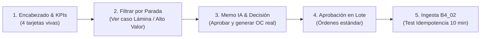

# 🎤 Guía Maestra para la Exposición Final del Proyecto — E2 SAS
> **Sistema Inteligente de Gestión de Inventarios, Reposición y Producción 4.0**  
> **Universidad de Medellín — Facultad de Ingenierías — Ingeniería Industrial**  
> **Asignatura:** Producción 4.0 / Énfasis 2  
> **Equipo Consultor:** Julian & Equipo de Ingeniería Industrial  
> **Calificación Objetivo:** **5.0 / 5.0**

---

## 🧭 1. Resumen Ejecutivo de la Estrategia de Sustentación

El jurado y el profesor de la Universidad de Medellín evaluarán el proyecto bajo una premisa fundamental de Producción 4.0:
> **"Tener piezas no es tener sistema. El sistema es el orden en que corren, cómo se comunican mediante contratos de datos, cómo garantizan que la base de datos sea la única verdad, y cómo la ingeniería gobierna a la inteligencia artificial mediante paradas y supervisión humana."**

### 🎯 La Tesis Central que debe defender el equipo:
1. **Separación de Responsabilidades:** El cálculo del reorden, el lote económico y la explosión de materiales son **fórmulas matemáticas determinísticas** ($ROP, SS, EOQ, MRP, ABC, SLA$). La Inteligencia Artificial se utiliza **exclusivamente** para dos tareas: *interpretar lo sucio* (normalización semántica) y *contextualizar para decidir* (memos ejecutivos y justificación de paradas). **0% alucinación en los números**.
2. **Del Archivo al Registro (Protocolo B4_02):** El archivo CSV es solo la remisión; la base de datos PostgreSQL/Supabase es el Kardex inmutable. El sistema garantiza las dos propiedades no negociables: **Idempotencia** (cargar el mismo archivo no duplica inventario) y **Acumulabilidad** (los lotes nuevos se suman a la historia).
3. **Orquestación Mixta con Criterios de Parada Calibrados:** Flujo secuencial determinístico para el camino conocido, con paradas obligatorias por **alto valor** ($> \$20\text{M COP}$), **riesgo de proveedor** ($SLA < 20\%$) o **duda patrimonial** ($ERI$ desalineado).
4. **Supervisión Humana Obligatoria (Human-in-the-Loop):** Ningún sistema compromete dinero por su cuenta. El software propone en memoria, detiene ante anomalías y solo crea la Orden de Compra oficial cuando el humano presiona "Aprobar" en el tablero de control.

---

## ⏱️ 2. Estructura y Cronograma Minuto a Minuto (Pitch de 15 Minutos)

```mermaid
gantt
    title Cronograma de Sustentación Final E2 SAS (15 Minutos)
    dateFormat  m
    axisFormat %M m
    1. Apertura e Impacto AS-IS ($ COP) :a1, 0, 2m
    2. Arquitectura de 4 Capas y Contratos :a2, after a1, 2m
    3. Ingesta B4_02, Idempotencia y Datos 3FN :a3, after a2, 3m
    4. LIVE DEMO en Vivo (Tablero Streamlit) :a4, after a3, 5m
    5. Criterios de Parada e Instrumentación :a5, after a4, 2m
    6. Conclusiones y Defensa ante Jurado :a6, after a5, 1m
```

| Bloque / Fase | Tiempo | Mensaje Clave | Entregable / Evidencia |
|---|:---:|---|---|
| **1. Apertura: El Dilema E2 SAS** | **2.0 min** | La paradoja: planta parada por lámina ($3.801M COP en riesgo) vs $3.550M COP en plata muerta. | Scorecard AS-IS con métricas monetizadas. |
| **2. Arquitectura: De Piezas a Sistema** | **2.0 min** | Cómo conectamos las piezas: 4 capas desacopladas, contratos estrictos que devuelven datos y no párrafos. | Diagrama de Arquitectura Oficial (SVG interactivo). |
| **3. Ingesta B4_02: Del Archivo al Registro** | **3.0 min** | Los 5 pasos de ingesta. Demostración de Idempotencia y Acumulabilidad. Por qué la base manda y no el archivo. | Módulo `analisis_cambios.py` y pruebas de doble carga. |
| **4. LIVE DEMO: El Tablero en Acción** | **5.0 min** | Correr la reposición, evaluar las paradas asistidas por IA, aprobar una OC real en Supabase y lote estándar. | Aplicación `app.py` corriendo en vivo en el navegador. |
| **5. Instrumentación y Criterios de Parada** | **2.0 min** | Cómo el sistema se mide a sí mismo (auditoría de corridas) y cómo calibramos los umbrales de dinero y SLA. | Bitácora de auditoría y métricas de parada. |
| **6. Cierre y Tesis de Negocio** | **1.0 min** | "La IA no reemplaza al ingeniero industrial; le da instrumentos de precisión para tomar decisiones auditables". | Conclusiones e impacto ROI proyectado. |

---

## 🖥️ 3. Guion Diapositiva por Diapositiva (Qué Proyectar y Qué Decir)

---

### 🔹 Diapositiva 1: Portada y Apertura de Alto Impacto (1.0 min)
* **Visual:** Logo de E2 SAS, título ejecutivo *"Sistema de Optimización, Reposición Inteligente y Producción 4.0"*, nombres de los ingenieros y afiliación institucional (Universidad de Medellín).
* **Guion del orador:**
  > *"Buenos días, profesor y miembros del comité evaluador. Hace unos meses, la Gerencia de Operaciones de E2 SAS —fabricante con más de 10 años en mobiliario metálico para oficina— nos entregó un desafío crítico: su fábrica vivía una contradicción constante. Se detenían las líneas de corte y soldadura por falta de lámina de acero, mientras que sus bodegas estaban saturadas con más de $3.500 millones de pesos en inventario inmóvil.
  >
  > Hoy no venimos a mostrarles fórmulas aisladas en un cuaderno ni scripts sueltos en una carpeta. Venimos a presentarles un **Sistema Integral de Producción 4.0**, completamente funcional, respaldado por una base de datos relacional en la nube, gobernado por contratos matemáticos determinísticos y orquestado con salvaguardas de inteligencia artificial y supervisión humana."*

---

### 🔹 Diapositiva 2: El Diagnóstico AS-IS y la Línea Base Cuantificada (2.0 min)
* **Visual:** Scorecard Maestro con los 4 pilares en rojo y su traducción a pesos colombianos ($ COP):
  1. **Lámina:** Lead Time declarado de 12 días vs. **20.8 días reales**, **SLA de entrega del 2.80%**, **8.448 horas en riesgo de parada** ($\$3.801.600.000\text{ COP}$).
  2. **Plata Muerta:** **301 de 420 SKUs (71.7%)** sin ninguna salida en 21 meses ($\$3.550.022.309\text{ COP}$ inmovilizados, con costo de posesión $H=25\%$ de **$\$887.505.577\text{ COP/año}$**).
  3. **Exactitud de Registro (ERI):** **0.00% en SKUs activos**. Brecha contable de $\$48.760\text{M COP}$ provocada por **162.142 unidades de compras físicas recibidas pero nunca asentadas en el ERP**.
  4. **Picos de Archivadores:** Coeficiente de variación $CV=48.7\%$ desbordando en **3.6 veces el stock máximo rígido** del ERP.
* **Guion del orador:**
  > *"Lo primero que descubrimos es que los problemas de la planta no eran de percepción, eran matemáticos. Medimos la línea base con rigor financiero:
  > En lámina, los proveedores fallan el 97% de las veces; la fábrica esperaba el insumo en 12 días y llegaba en 21, generando un riesgo de parada valorado a $450.000 pesos la hora.
  > Al mismo tiempo, el 71% del catálogo eran piezas fantasma que generaban casi $900 millones al año solo por tenerlas guardadas ocupando espacio.
  > Y la causa raíz de la desconfianza: el sistema decía que había material porque se habían comprado 162.000 unidades que jamás se cargaron formalmente al Kardex. Esta línea base es el punto de partida que nuestro sistema resuelve."*

---

### 🔹 Diapositiva 3: Arquitectura del Sistema — Las 4 Capas y los Contratos (2.0 min)
* **Visual:** Diagrama interactivo de arquitectura (el mismo de [`diagrams/arquitectura-sistema-completo.html`](diagrams/arquitectura-sistema-completo.html)) mostrando las 4 capas:
  1. *Capa de Interacción:* Tablero Streamlit SaaS.
  2. *Capa de Orquestación:* `orquestador.py` con lógica mixta y paradas.
  3. *Capa Lógica Modular:* Fórmulas determinísticas (`nucleo/`) + IA contextualizadora.
  4. *Capa de Datos:* Supabase PostgreSQL 3FN (la única fuente de verdad).
* **Guion del orador:**
  > *"Para resolver esto, aplicamos el principio visto en clase: **las piezas no son el sistema; el sistema es el orden en que corren y cómo se comunican**.
  > Estructuramos una arquitectura desacoplada en 4 capas estrictas donde cada capa solo habla con la adyacente. La interfaz jamás toca la base de datos de manera directa; todo pasa por el orquestador.
  > Y definimos **contratos de datos rigurosos**: ninguna función entrega párrafos de texto ambiguos. Cada módulo recibe listas tipadas con SKUs y demandas, y entrega números exactos: ROP, EOQ, Stock de Seguridad y Delta de inventario. Si una estación de la línea entregara piezas a medio ensamblar, la línea se detendría. En software industrial es exactamente igual."*

---

### 🔹 Diapositiva 4: Protocolo de Ingesta B4_02 — Del Archivo al Registro (2.0 min)
* **Visual:** Los 5 pasos canónicos de la ingesta y el contraste conceptual:
  * *Archivo (Remisión)* vs *Base de Datos (Kardex Mandante)*.
  * Diagrama de los 5 Pasos: **1. Escoger ➔ 2. Validar ➔ 3. Normalizar (IA) ➔ 4. Reportar ➔ 5. Escribir**.
  * Cuadro de los dos requisitos duros: **Idempotencia** y **Carga Acumulativa**.
* **Guion del orador:**
  > *"Uno de los mayores aprendizajes del curso fue: **el archivo no es el dato, es solo la remisión**. Si un sistema lee directamente de archivos de Excel o CSV en cada corrida, opera sobre una pila de papeles y sufre de amnesia.
  > Implementamos el protocolo canónico en 5 pasos. El paso 4 rinde cuentas obligatoriamente: le dice al usuario cuántas filas leyó, cuántas aceptó y exactamente cuáles rechazó por fechas incongruentes o claves duplicadas.
  > Además, nuestro pipeline cumple con los dos requisitos duros: es **idempotente**, lo que significa que si el usuario carga el mismo archivo dos veces por error, el sistema detecta las claves primarias compuestas y no duplica un solo tornillo; y es **acumulativo**, permitiendo incorporar los nuevos lotes mensuales sin borrar el historial anterior."*

---

### 🔹 Diapositiva 5: La Tesis del Curso — La Proporción Fórmula vs. IA (1.5 min)
* **Visual:** Gráfico de balanza o proporción: **8 Módulos de Fórmulas Exactas (0% Alucinación) vs. 2 Tareas Puntuales de IA (Normalización y Explicación Ejecutiva)**.
* **Guion del orador:**
  > *"En Producción 4.0 existe una tentación común: pedirle a un modelo de lenguaje que calcule el punto de reorden o el lote de compra. Nosotros demostramos por qué eso es un error de ingeniería gravísimo.
  > Un modelo de IA es probabilístico; puede entregar 450 unidades hoy y 520 mañana con los mismos datos. El cálculo del reorden ($d \cdot LT + Z\sigma$), el lote económico ($\sqrt{2DS/H}$) y la explosión neta de materiales son álgebra exacta. No permitimos alucinación en los costos.
  > ¿Dónde vive entonces la Inteligencia Artificial en nuestro sistema? En dos lugares estratégicos:
  > Primero, en la ingesta, interpretando texto sucio y categorizando insumos mal escritos.
  > Y segundo, como **Vigilante y Redactor Ejecutivo**: analiza la propuesta matemática, evalúa el costo de parada ($450.000/h) frente al costo de posesión, y le redacta al Gerente un dictamen claro para facilitar la toma de decisiones."*

---

### 🔹 Diapositiva 6: Demostración en Vivo (LIVE DEMO) del Software (5.0 min)
*(Ver la sección detallada 4 de esta guía para el libreto paso a paso del clic a clic)*.
* **Qué se muestra en vivo:**
  1. `app.py` abriendo en el navegador: 4 KPI Cards en tiempo real sincronizados con Supabase.
  2. Pestaña 1: La Consola de Decisiones, filtrando por paradas (`REQUIERE_AUTORIZACION_GERENCIAL`, `REQUIERE_VERIFICACION_FISICA`).
  3. Muestra del memo ejecutivo de la IA contextualizadora para un ítem crítico (ej. Lámina Cold Rolled).
  4. **Aprobación de la Orden:** El orquestador genera la OC oficial consecutiva (ej. `OC-7001`) y la asienta en Supabase en tiempo real.
  5. Aprobación en Lote de las órdenes estándar.
  6. Pestaña 2: Demostración de la Ingesta B4_02 y botón de verificación de idempotencia en 10 minutos.

---

### 🔹 Diapositiva 7: Criterios de Parada e Instrumentación del Sistema (1.5 min)
* **Visual:** Tabla de Criterios de Parada y el principio: *"Una máquina sin instrumentos se opera a punta de intuición"*.
  * Parada 1: Monto $> \$20\text{M COP}$ (Protección del capital).
  * Parada 2: Proveedor con $SLA < 20\%$ (Prevención de quiebre por mora).
  * Parada 3: ERI desalineado (Prevención de compras basadas en saldos fantasma).
  * Instrumentación: Identificador de corrida `RUN-ID`, registro de aprobadas/rechazadas por el humano y tiempo de cómputo.
* **Guion del orador:**
  > *"Un sistema automatizado no puede comprometer dinero a ciegas. Si el sistema compra todo automáticamente, un error quiebra a la empresa; si pregunta por cada tornillo, es más lento que un formulario de Excel.
  > Por eso calibramos **criterios de parada de ingeniería**:
  > Si una orden supera los $20 millones de pesos, se frena y exige visto bueno de Gerencia.
  > Si el proveedor tiene un SLA inferior al 20%, se frena y alerta el riesgo de mora.
  > Y si el Kardex no coincide con el conteo físico, se frena porque no podemos comprar sobre saldos fantasma.
  > Además, el sistema se instrumenta a sí mismo: cada corrida genera un identificador único auditado en la base de datos, registrando qué se propuso, qué se aprobó y quién tomó la decisión."*

---

### 🔹 Diapositiva 8: Conclusiones, Impacto de Negocio y Cierre (1.0 min)
* **Visual:** Cuadro comparativo ANTES (AS-IS) vs. DESPUÉS (TO-BE con el Sistema E2 SAS):
  * Inventario inútil reducido a políticas EOQ dinámicas.
  * SLA protegido mediante Stock de Seguridad calculado con variabilidad real de Lead Time.
  * Trazabilidad 100% auditable entre Kardex y Órdenes de Compra.
* **Guion del orador:**
  > *"En conclusión: transformamos un conjunto de datos desarticulados y quejas de pasillo en una plataforma industrial robusta, auditable y en producción.
  > Demostramos que la Industria 4.0 no consiste en sustituir al ser humano ni en poner modelos de lenguaje a hacer aritmética, sino en dotar a las organizaciones de arquitecturas sólidas donde los datos gobiernan la operación y la inteligencia artificial actúa como un copiloto confiable.
  > Agradecemos al profesor por los aprendizajes durante el semestre y abrimos el espacio para las preguntas del jurado evaluador. Muchas gracias."*

---

## 🎬 4. Guion Maestro para la Demostración en Vivo (Live Demo)

Para garantizar un 5.0, la demostración debe ser fluida, segura y ejecutarse en menos de 5 minutos siguiendo este guion:

### Paso 1: Presentar el Tablero y la Conexión Live (45 segundos)
1. Abrir el navegador en `http://localhost:8501`.
2. Señalar el badge verde en el sidebar: **`● Supabase PostgreSQL Live`**.
3. Explicar los 4 KPIs superiores:
   * **Exactitud ERI:** Muestra los SKUs exactos sobre el total auditado.
   * **Inversión Reorden Sugerida:** Monto total en COP calculado en memoria por el pipeline EOQ/ROP.
   * **Cumplimiento SLA Proveedores:** Con la mora promedio medida en días reales.
   * **Concentración Clase A:** El porcentaje exacto del Pareto 80/20.
4. *Frase clave:* *"Todo lo que ven aquí no está quemado en código; se calcula dinámicamente consultando la base de datos en la nube."*

### Paso 2: Mostrar la Consola de Decisiones y los Criterios de Parada (90 segundos)
1. En la **Pestaña 1 (⚡ Consola de Decisiones)**, mostrar la tabla de propuestas de reposición.
2. Usar el filtro **Criterio de Parada** y seleccionar `REQUIERE_AUTORIZACION_GERENCIAL` o `PROVEEDOR_ALTO_RIESGO_MORA`.
3. Seleccionar en el menú desplegable un insumo clave (por ejemplo, una lámina de acero o tubería estructural).
4. Señalar el **Memo Ejecutivo de Asistencia IA**:
   * Mostrar el **Dictamen** y el análisis de la IA: *"Fíjense cómo la IA no calculó el EOQ de 250 unidades ni el ROP de 120; la IA leyó el resultado matemático, identificó que el proveedor tiene mora histórica y que la inversión supera el umbral, y redactó este memo recomendando autorización especial."*

### Paso 3: Ejecutar la Transacción Real (Human-in-the-Loop) (60 segundos)
1. Escribir una observación en el campo de texto: `"Aprobado en comité directivo según plan de producción."`
2. Hacer clic en **`✓ Aprobar y Generar OC`**.
3. Mostrar la alerta verde de éxito: `Orden creada: OC-XXXX para SKU-XXXX`.
4. Abrir el desplegable inferior: **Ver Órdenes Recientes Creadas en Supabase (`ordenes_compra`)**.
5. Mostrar que la orden acaba de crearse en la base de datos con su fecha, cantidad, proveedor y costo unitario.
6. *Frase clave:* *"Aquí demostramos que el sistema no ensucia la base de datos con borradores. La transacción formal ocurre solo cuando el decisor humano la valida."*

### Paso 4: Aprobación Estándar en Lote (45 segundos)
1. Señalar el panel lateral derecho: **Lote Estándar (Sin Paradas)**.
2. Explicar: *"Para los insumos rutinarios que no tienen problemas de SLA ni descuadres físicos y no superan el umbral, el planeador no pierde tiempo; hace clic en 'Aprobar Estándar en Lote' y el sistema emite las órdenes masivamente."*
3. Oprimir el botón y mostrar cómo se actualizan las propuestas pendientes.

### Paso 5: Demostrar la Ingesta B4_02 y la Idempotencia (60 segundos)
1. Pasar a la **Pestaña 2 (📥 Ingesta 5 Pasos & Control de Datos)**.
2. Mostrar los 5 pasos del protocolo B4_02 en la interfaz.
3. Hacer clic en el botón de verificación: **`🔬 Probar Idempotencia & Acumulación`**.
4. Mostrar el resultado de la prueba:
   * *Prueba de doble carga:* El conteo de filas se mantiene constante (Idempotencia verificada).
   * *Prueba acumulativa:* Los datos incrementales se sumaron sin sobreescribir la historia.
5. *Frase de impacto:* *"El profesor nos desafió en la clase B4_02 a responder si nuestro sistema aguantaba que alguien cargara dos veces el mismo archivo sin duplicar el inventario. Aquí está la evidencia técnica en vivo: el sistema no duplica nada."*

---

## 🛡️ 5. Banco de Defensa Estratégica: Preguntas Clave del Jurado y Respuestas

Este es el cuestionario más probable que hará el profesor o jurado evaluador, con las respuestas exactas fundamentadas en el código:

### ❓ Pregunta 1: "¿Por qué decidieron que el ROP y el EOQ se calcularan con fórmulas y no con un agente de IA?"
* **Respuesta de 5.0:**
  > *"Por rigor de ingeniería y control de costos. Las fórmulas de ROP ($d \cdot LT + SS$) y EOQ ($\sqrt{2DS/H}$) son modelos analíticos cerrados derivados del cálculo diferencial y la teoría de probabilidades. Si usamos un LLM para calcular la raíz cuadrada del lote económico, incurrimos en tres faltas graves:
  > 1. **Riesgo de alucinación:** un modelo probabilístico puede devolver valores inconsistentes entre corridas.
  > 2. **Costo computacional innecesario:** llamar a una API de lenguaje para multiplicar y dividir es millones de veces más costoso que una función nativa en Python.
  > 3. **Falta de auditabilidad:** ante una auditoría contable o de revisoría fiscal, una fórmula matemática es 100% defendible; un 'prompt' de IA no lo es. La IA la reservamos para interpretar lenguaje natural sucio y redactar justificaciones contextuales."*

---

### ❓ Pregunta 2: "¿Qué tipo de orquestación escogieron (Secuencia Fija, Agente o Mixta) y por qué?"
* **Respuesta de 5.0:**
  > *"Escogimos una **Orquestación Mixta con predominancia determinística**.
  > En nuestra operación de manufactura, el orden de los pasos principales es totalmente predecible y estandarizado: primero se audita el ERI, luego se clasifica el ABC, se cruza el SLA de proveedores, se explotan los requerimientos netos del MRP y se calcula el punto de reorden. Pagarle a un agente de IA para que 'adivine' ese orden sería un desperdicio de recursos.
  > Sin embargo, la orquestación es mixta porque incorpora **bifurcaciones gobernadas por condiciones de parada**: cuando los datos presentan anomalías (alto monto, riesgo de mora o saldo dudoso), el flujo no sigue en piloto automático; invoca al módulo de IA explicativa y se detiene obligatoriamente para requerir supervisión humana."*

---

### ❓ Pregunta 3: "¿Cómo aseguran que el sistema no duplique inventarios si el usuario sube dos veces el archivo de compras o movimientos?"
* **Respuesta de 5.0:**
  > *"Mediante la propiedad de **Idempotencia** implementada en nuestro módulo [`nucleo/limpieza.py`](nucleo/limpieza.py) y [`nucleo/analisis_cambios.py`](nucleo/analisis_cambios.py) según los lineamientos de la clase B4_02.
  > Cada entidad relacional en Supabase posee una **clave primaria o compuesta estricta** (por ejemplo, el código de orden de compra `orden_compra` o la tupla `(sku, fecha, tipo_movimiento)` en Kardex).
  > Cuando el archivo entra en el paso 5 (Escribir), el pipeline ejecuta un patrón de ingesta `UPSERT` o filtrado previo contra el estado de la base de datos: si los registros ya existen con la misma clave e integridad, se descartan silenciosamente de la inserción y se reportan en la bitácora como registros preexistentes sin incrementar el saldo."*

---

### ❓ Pregunta 4: "¿Por qué el ERI en SKUs activos dio 0.0% en el diagnóstico inicial y cómo lo soluciona su sistema?"
* **Respuesta de 5.0:**
  > *"El ERI (Exactitud en el Registro de Inventario) dio 0.0% en los 119 materiales activos porque existía un desfase sistémico entre compras y almacén: descubrimos que **162.142 unidades de insumos habían sido recibidas físicamente pero nunca fueron asentadas en el ERP**.
  > Producción consumía los materiales en piso, pero el Kardex registraba consumos sin recepciones previas, llevando saldos a números negativos o inconsistentes y generando más de $48.000 millones de pesos en descuadre contable bruto. Esto obligó al jefe de bodega a llevar un cuaderno manual.
  > Nuestro sistema lo soluciona cerrando el circuito: las órdenes de compra nacen aprobadas en el sistema con un código único (`OC-XXXX`), y la ingesta del Kardex valida la integridad referencial contra las órdenes emitidas, impidiendo consumos ciegos y forzando la reconciliación antes de sugerir nuevas compras."*

---

### ❓ Pregunta 5: "¿Cómo definieron y calibraron el umbral de parada de $20 millones de pesos y el SLA mínimo del 20%?"
* **Respuesta de 5.0:**
  > *"Como vimos en la clase de orquestación, los umbrales no se inventan; son decisiones de ingeniería calibradas con base en la línea base:
  > El umbral de **$20.000.000 COP** corresponde al percentil superior de compras individuales de materias primas estratégicas (Láminas y Tuberías Clase A). Comprometer más de $20M en una sola orden impacta directamente el flujo de caja operativo y supera el límite de atribución de un auxiliar de compras, requiriendo autorización de Gerencia.
  > El umbral de **SLA < 20%** se calibró a partir del hallazgo crítico de los proveedores de lámina, cuyo SLA real fue de un paupérrimo **2.80% con mora promedio de 11 días**. Cualquier proveedor con cumplimiento menor al 20% es catalogado como 'proveedor en zona de peligro', impidiendo la emisión automática para que Compras renegocie fechas de entrega o active proveedores alternos."*

---

### ❓ Pregunta 6: "¿Qué pasa si se cae el servicio de internet o la API de IA durante la operación?"
* **Respuesta de 5.0:**
  > *"Esa es precisamente la ventaja de nuestra arquitectura desacoplada: **la planta nunca se detiene**.
  > Si la API del modelo de lenguaje no responde o no hay conexión externa a la IA, el motor de cálculo determinístico sigue operando al 100%: calcula el EOQ, el ROP, el MRP y el semáforo de inventario con precisión matemática en milisegundos.
  > Lo único que se degrada grácilmente es la generación del memo redactado en lenguaje natural, sustituyéndose por una plantilla estandarizada de texto técnico. El núcleo de ingeniería nunca depende de un servicio externo para saber qué material se necesita pedir."*

---

## 👥 6. Asignación de Roles y Consejos de Puesta en Escena (Para el Día D)

### 🎭 Reparto de Voces sugerido:
* **Expositor 1 (Líder / Negocio e Impacto Financiero):**
  * Presenta Diapositivas 1 y 2 (Contexto, las 4 quejas gerenciales y la Línea Base en $ COP).
  * Cierra con Diapositiva 8 (Conclusiones y retorno de inversión).
  * *Tono:* Ejecutivo, seguro, enfocado en el dolor del negocio y el impacto en dinero.
* **Expositor 2 (Arquitecto de Datos y Sistemas):**
  * Presenta Diapositiva 3 (Arquitectura de 4 capas y contratos de módulos).
  * Presenta Diapositiva 4 (Protocolo B4_02 de ingesta, idempotencia y Supabase 3FN).
  * *Tono:* Riguroso, técnico, dominio de la integridad referencial y de los contratos entre piezas.
* **Expositor 3 (Operaciones, Live Demo y Demostración):**
  * Presenta Diapositiva 5 (Tesis de la proporción Fórmula vs IA).
  * Conduce la **Demostración en Vivo (Live Demo)** en el navegador operando `app.py`.
  * Explica los criterios de parada e instrumentación (Diapositiva 7).
  * *Tono:* Ágil, dinámico, control absoluto del ratón y del flujo de la aplicación.

### ⚠️ Reglas de Oro para Asegurar el 5.0:
1. **Tener la aplicación corriendo ANTES de empezar:** Abrir PowerShell o la terminal, ejecutar `streamlit run app.py` y dejar la pestaña abierta en el navegador lista y maximizada en pantalla completa (F11). No perder tiempo iniciando servidores frente al jurado.
2. **Cero lectura de diapositivas:** Las diapositivas deben contener diagramas, tablas con cifras monetarias y visuales de alto contraste. Las palabras las dicen los ingenieros.
3. **No redondear cifras críticas:** Decir *"El SLA de lámina es del 2.80% con 8.448 horas en riesgo de parada"* genera diez veces más autoridad que decir *"el SLA es muy bajito y se pierde mucho tiempo"*.
4. **Voz activa y de autoridad:** No decir *"intentamos hacer un sistema"*; decir *"diseñamos, normalizamos y pusimos en producción una arquitectura modular en 4 capas"*.
5. **Ante una pregunta del jurado:** Dejar que el jurado termine de formular la pregunta, tomar 2 segundos para ordenar la idea, y responder con la fórmula o la evidencia del código: *"Esa decisión la tomamos en el archivo `orquestador.py`, línea 26..."*. Eso demuestra maestría total del repositorio.

---
*Documento estructurado bajo los estándares de Producción 4.0 — Universidad de Medellín.*
